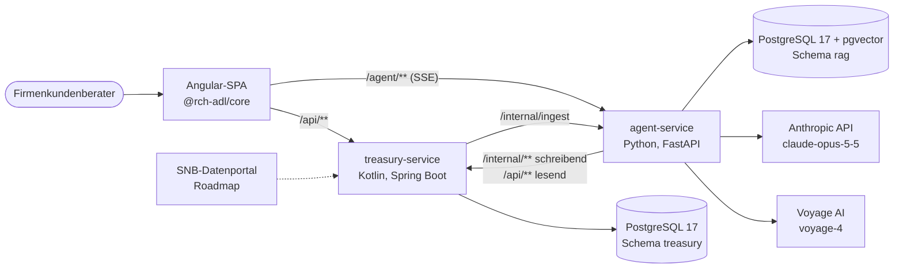
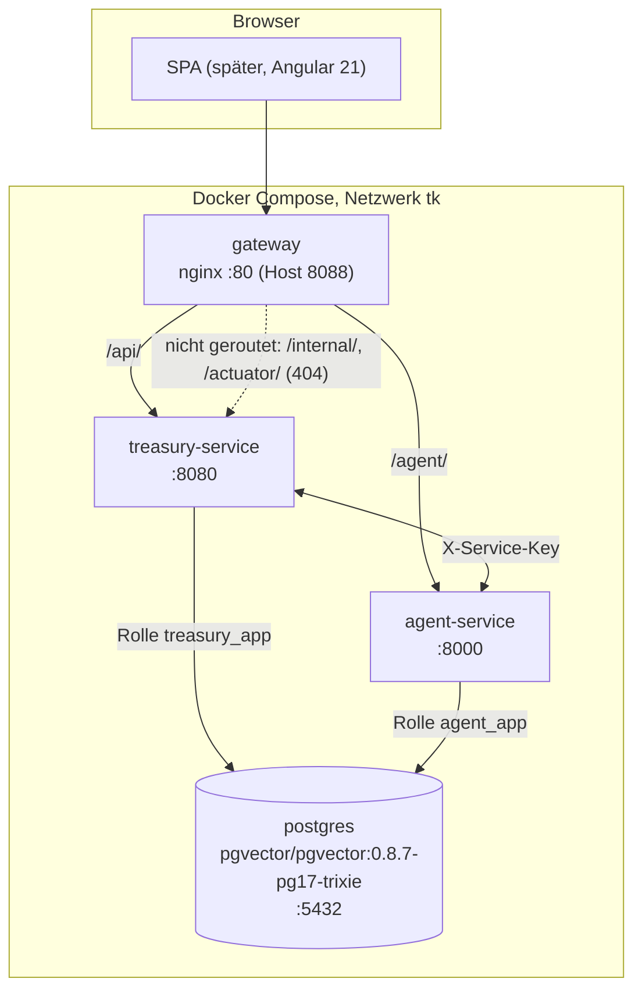
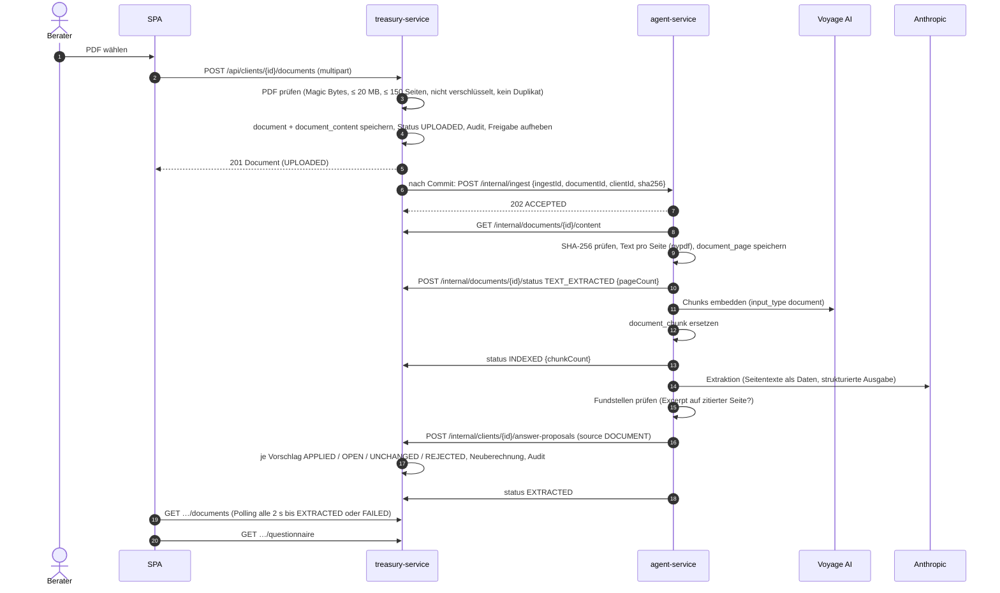
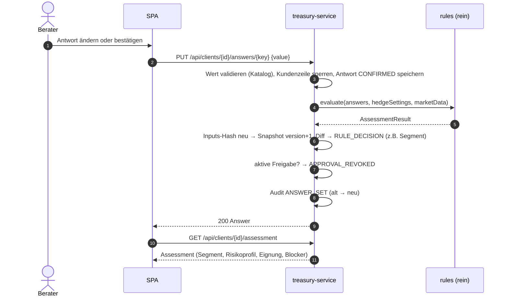
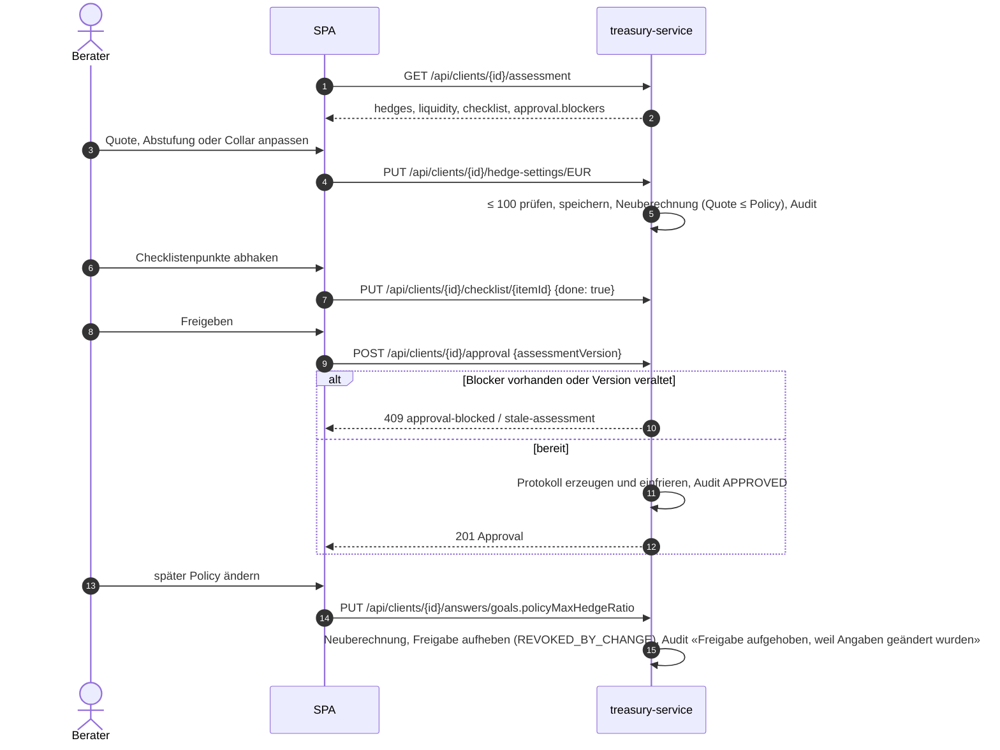
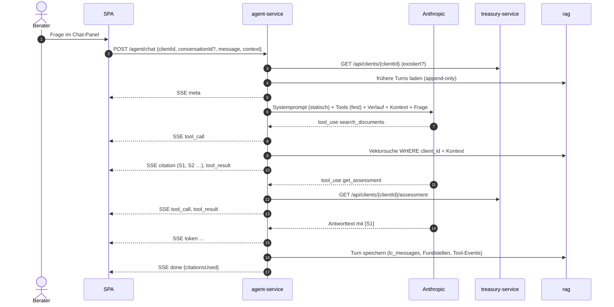
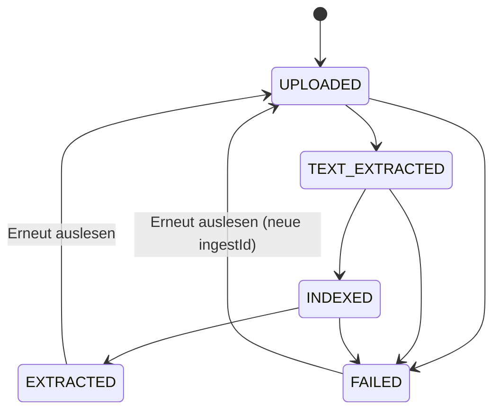
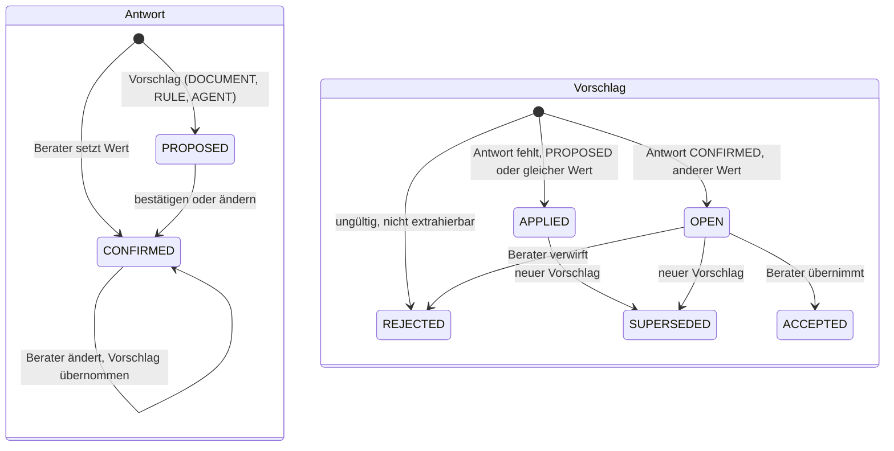

# Architektur

Stand: 18.11.2026 · Status: Entwurf für die Umsetzung im Hackathon

Dieses Dokument ist die Bauanleitung für `treasury-service` (Kotlin) und `agent-service` (Python). Fachliche Abläufe und Akzeptanzkriterien stehen in [`specs/use-cases.md`](specs/use-cases.md), die Verträge in [`api/treasury-service.openapi.yaml`](api/treasury-service.openapi.yaml) und [`api/agent-service.openapi.yaml`](api/agent-service.openapi.yaml). Regeln und Formeln: [`regelwerk.md`](regelwerk.md). Bei Widersprüchen gilt: Regelwerk vor Prototyp, OpenAPI vor diesem Dokument bei Feldnamen.

## 1. Leitplanken

| Nr. | Invariante | Wo durchgesetzt |
| --- | --- | --- |
| INV-1 | Segment, Risikoprofil, Eignung, Quoten und Liquiditätsaufteilung berechnet nur das Regelwerk im `treasury-service`. Das LLM liest aus, fragt nach, formuliert und erklärt. | Paket `rules`, kein LLM-Aufruf im `treasury-service` |
| INV-2 | Absicherungsquote ≤ min(Treasury-Policy, 100 % der Nettoposition). | `rules` (R-HED-02), Validierung der Absicherungseinstellungen |
| INV-3 | Freigabe nur ohne Blocker: keine fehlenden Pflichtangaben, keine Antworten im Status `PROPOSED`, keine offenen Vorschläge (`OPEN`), Checkliste erledigt, kein Dokument in Verarbeitung. | `advisory.ApprovalService` |
| INV-4 | Jede Änderung an Antworten, Absicherungseinstellungen, Checkliste, Begründung, Stammdaten oder Unterlagen hebt eine aktive Freigabe auf. | `assessment.ChangeTracker` |
| INV-5 | KI erzeugt nur Vorschläge. Bestätigte Werte ändert nur der Berater. Kein Endpunkt erlaubt der KI, zu bestätigen oder freizugeben. | `questionnaire.ProposalService`, `/internal/**` |
| INV-6 | Mandantentrennung im RAG: jede Suche ist per `client_id` gefiltert; die `clientId` kommt aus dem Request-Kontext, nie aus Tool-Argumenten des LLM. | `agent-service` `rag.search`, Tool-Runtime |
| INV-7 | Jede Regelentscheidung steht mit Regel-ID und Rechtsgrundlage im Audit-Trail. Der Audit-Trail ist append-only. | `audit`, DB-Trigger |

## 2. Kontextsicht



Nutzer ist nur der Berater. Der Kunde (CFO) sieht die Ergebnisse im Termin, hat aber keinen Zugang.

## 3. Containersicht



| Container | Technik | Port (Host) | Verantwortung |
| --- | --- | --- | --- |
| `gateway` | nginx 1.30.6 | 8088 | Eine Origin für SPA, `/api/**` und `/agent/**`. Sperrt `/internal/**` und `/actuator/**`. Liefert das gebaute Frontend aus (`frontend/dist/treasury-kompass/browser`). |
| `treasury-service` | Kotlin 2.3.21, Spring Boot 4.1.2, Java 21 | 8080 | Kunden, Unterlagen (PDF-Bytes), Fragebogen, Regelwerk, Absicherung, Liquidität, Checkliste, Freigabe, Protokoll, Audit-Trail |
| `agent-service` | Python 3.12, FastAPI, LangChain 1.x | 8000 | Ingest (Parsing, Chunking, Embeddings), Extraktion mit Fundstellen, Chat-Agent mit Tools, Begründungsentwurf, Gesprächsverlauf |
| `postgres` | PostgreSQL 17, pgvector 0.8.7 | 5432 | Schema `treasury` (Flyway, Rolle `treasury_app`), Schema `rag` (Rolle `agent_app`) |

Lokale Entwicklung ohne Gateway: Angular-Dev-Server-Proxy (`proxy.conf.json`) leitet `/api` auf `localhost:8080` und `/agent` auf `localhost:8000`.

## 4. Komponenten

### 4.1 treasury-service

Basispaket `ch.treasurykompass.treasury`, Schnitt nach Fachlichkeit. Controller sind dünn, Logik liegt in Services, Regeln im reinen Paket `rules`.

Gradle-Aufbau: Die Spring-Boot-App ist das Root-Projekt `services/treasury-service`. Das Regelwerk ist das Subprojekt `services/treasury-service/rules` (`settings.gradle.kts`: `include("rules")`; App: `implementation(project(":rules"))`). `rules` ist reines Kotlin/JVM (nur Plugin `kotlin("jvm")`, keine Spring-, JPA- oder Jackson-Abhängigkeit, eigene Unit-Tests mit den Werten aus `regelwerk.md` Abschnitt 9), Paket weiterhin `ch.treasurykompass.treasury.rules`. Damit ist zur Compile-Zeit garantiert, dass die Regeln frameworkfrei bleiben (INV-1), und App und Regelwerk lassen sich parallel bauen.

| Paket | Inhalt |
| --- | --- |
| `common` | Problem-Details-Handler (RFC 9457), `AdvisorContext` (gemockte Berateridentität aus Konfiguration), `Clock`-Bean, Konfiguration |
| `client` | `Client`-Entity, `ClientService`, `ClientController` (`/api/clients`) |
| `document` | `Document`, `DocumentContent` (bytea, eigene Tabelle), `PdfValidator` (Magic Bytes, Grösse, Seiten, Verschlüsselung mit PDFBox), `DocumentService`, `IngestDispatcher` (nach Commit, asynchron, Retry) |
| `questionnaire` | `QuestionCatalog` (Schlüssel, Texte, Typen, Pflicht, extrahierbar; siehe 6), `Answer`, `AnswerProposal`, `AnswerService`, `ProposalService`, `QuestionnaireController` |
| `rules` (Subprojekt `rules/`) | Reines Kotlin ohne Spring und ohne DB: `RuleEngine.evaluate(input, hedgeSettings, marketData): AssessmentResult`, je Regel eine Datei (`SegmentRule`, `ExposureCalculator`, `RiskProfileRule`, `SuitabilityRule`, `HedgeCalculator`, `ScenarioCalculator`, `LiquidityAllocator`, `ChecklistBuilder`, `ReasonWriter`), `RuleCatalog` (IDs, Titel, Rechtsgrundlage). Die App mappt `AssessmentResult` auf die API-DTOs. |
| `assessment` | `AssessmentService` (Snapshot, Inputs-Hash, Version, Diff der Entscheidungen → Audit), `ChangeTracker` (zentraler Einstieg nach jeder Änderung) |
| `advisory` | `HedgeSetting`, `ChecklistState`, `Approval`, `Rationale`, `ApprovalService`, `ProtocolBuilder`, Controller |
| `audit` | `AuditEvent` (append-only), `AuditService`, `AuditController` |
| `marketdata` | `MarketDataProperties` (Demo-Kurse und -Zinsen aus `application.yml`), Controller |
| `internalapi` | `InternalApiKeyFilter` (nur `/internal/**`), Controller für Dokumentinhalt, Status-Callback, Antwortvorschläge, Simulation |
| `agentclient` | `AgentServiceClient` (Spring `RestClient`, Timeouts, Retry) |
| `demo` | `DemoDataSeeder` (`@Profile("demo")`, idempotent, feste UUIDs; Werte in Abschnitt 13) |

Änderungsfluss (eine Stelle für INV-4 und INV-7):

1. Ein Befehl (z.B. Antwort setzen) sperrt die Kundenzeile (`SELECT … FOR UPDATE`) und schreibt die Änderung.
2. `ChangeTracker.onChange(clientId, trigger)` im selben Transaktionskontext: Assessment neu berechnen; ist der Inputs-Hash neu, Snapshot mit `version + 1` speichern; geänderte Entscheidungen als `RULE_DECISION` auditieren; aktive Freigabe aufheben (`APPROVAL_REVOKED`, Auslöser im Detail).
3. Fachliches Audit-Event des Befehls schreiben (z.B. `ANSWER_SET` mit alt → neu).

### 4.2 agent-service

```
app/
  main.py            FastAPI-App, Router, Lifespan (DB-Engine, schema.sql anwenden, httpx-Client)
  config.py          Settings (pydantic-settings, Env-Variablen aus Abschnitt 10)
  security.py        Abhängigkeit require_service_key für /internal/**
  db/engine.py       SQLAlchemy 2.1 AsyncEngine (psycopg 3)
  db/schema.sql      idempotentes DDL für Schema rag (Abschnitt 5.2)
  clients/treasury.py  httpx.AsyncClient gegen treasury-service (X-Service-Key, Timeouts, Retry)
  ingest/            router.py (POST /internal/ingest), pipeline.py (Stufen, Status-Callbacks),
                     pdf.py (pypdf, seitenweise), chunking.py, extraction.py (strukturierte Ausgabe),
                     citations.py (Fundstellen-Prüfung)
  rag/               store.py (Upsert Seiten/Chunks), search.py (Vektorsuche mit client_id-Filter)
  agent/             llm.py (ChatAnthropic-Fabrik), prompts.py (statische Systemprompts),
                     tools.py (Lese- und Vorschlags-Tools), graph.py (create_agent + Middleware),
                     sse.py (Event-Mapping), history.py (Turns laden/speichern)
  api/               chat.py, conversations.py, rationale.py, health.py
  models/            Pydantic-DTOs der API
tests/
```

| Modul | Verantwortung |
| --- | --- |
| `ingest` | Holt PDF-Bytes vom `treasury-service`, prüft SHA-256, extrahiert Text pro Seite, chunkt seitentreu, embedded mit Voyage, speichert in `rag`, extrahiert Kennzahlen mit Fundstelle, postet Vorschläge, meldet Status |
| `rag` | Speichert Seiten und Chunks, sucht mit Pflichtfilter `client_id` |
| `agent` | Chat-Agent (LangChain `create_agent`), Tools, SSE-Mapping, Verlauf |
| `clients` | Einziger Ort mit HTTP-Aufrufen an den `treasury-service` |

## 5. Datenmodell

Alle IDs `uuid` (ausser `audit_event.id`), Zeitstempel `timestamptz` (UTC), Beträge `numeric(14,2)` bzw. in JSON als Zahl in Mio. Keine Fremdschlüssel über Schemagrenzen.

### 5.1 Schema `treasury` (Flyway, `treasury-service`)

| Tabelle | Spalten | Schlüssel, Indizes |
| --- | --- | --- |
| `client` | `id`, `name varchar(200) not null`, `industry varchar(200)`, `employee_count int`, `fiscal_year int`, `short_label varchar(60)`, `created_at`, `updated_at` | PK `id`; unique `lower(name)` |
| `document` | `id`, `client_id`, `filename varchar(255)`, `content_type varchar(100)`, `size_bytes bigint`, `sha256 char(64)`, `page_count int`, `status varchar(20)` (check), `ingest_id uuid`, `chunk_count int`, `error_code varchar(40)`, `error_message varchar(500)`, `uploaded_at`, `uploaded_by varchar(100)`, `status_changed_at` | PK `id`; FK `client_id`; unique `(client_id, sha256)`; index `(client_id, uploaded_at desc)` |
| `document_content` | `document_id`, `bytes bytea not null` | PK/FK `document_id` (on delete cascade) |
| `answer` | `client_id`, `question_key varchar(64)`, `value jsonb not null`, `status varchar(16)` (`PROPOSED`, `CONFIRMED`), `source varchar(16)` (`DOCUMENT`, `RULE`, `AGENT`, `ADVISOR`), `proposal_id uuid` (Fundstelle, Konfidenz), `note varchar(300)`, `updated_at`, `confirmed_at`, `confirmed_by` | PK `(client_id, question_key)`; FK `proposal_id` |
| `answer_proposal` | `id`, `client_id`, `question_key`, `value jsonb`, `source varchar(16)` (`DOCUMENT`, `RULE`, `AGENT`), `status varchar(16)` (`OPEN`, `APPLIED`, `ACCEPTED`, `REJECTED`, `SUPERSEDED`), `document_id uuid`, `document_name varchar(255)`, `page int`, `location_label varchar(200)`, `excerpt varchar(600)`, `citation_verified boolean`, `confidence varchar(8)`, `rationale varchar(1000)`, `conversation_id uuid`, `created_at`, `decided_at`, `decided_by` | PK `id`; index `(client_id, status)`; index `(client_id, question_key)` |
| `hedge_setting` | `client_id`, `currency char(3)`, `start_ratio int` (null = Standard nach Profil), `step_down int not null default 10`, `collar_enabled boolean` (null = Standard), `updated_at` | PK `(client_id, currency)` |
| `checklist_state` | `client_id`, `item_id varchar(64)`, `done boolean`, `changed_at`, `changed_by` | PK `(client_id, item_id)` |
| `assessment_snapshot` | `client_id`, `version int`, `inputs_hash char(64)`, `result jsonb`, `created_at` | PK `(client_id, version)` |
| `rationale` | `client_id`, `assessment_version int`, `text text`, `source varchar(16)` (`AGENT_DRAFT`, `ADVISOR`), `saved_at`, `saved_by` | PK `client_id` |
| `approval` | `id`, `client_id`, `assessment_version int`, `approved_at`, `approved_by`, `protocol jsonb`, `protocol_text text`, `revoked_at`, `revoked_by`, `revocation_type varchar(20)` (`REVOKED_BY_CHANGE`, `WITHDRAWN`), `revocation_reason varchar(300)` | PK `id`; unique partial `(client_id) where revoked_at is null` |
| `audit_event` | `id bigserial`, `client_id`, `occurred_at`, `actor_type varchar(10)` (`ADVISOR`, `SYSTEM`, `RULE`, `AGENT`), `actor_name varchar(100)`, `event_type varchar(40)`, `message text` (Deutsch), `rule_id varchar(16)`, `legal_basis varchar(100)`, `assessment_version int`, `details jsonb` | PK `id`; index `(client_id, occurred_at desc)`; Trigger verbietet `UPDATE`/`DELETE` |

Hinweise für JPA (Hibernate 7.4): `bytea` ohne `@Lob` mappen (sonst `oid`), `DocumentContent` als eigene Entity laden, damit Listen keine Bytes ziehen. `jsonb` mit `@JdbcTypeCode(SqlTypes.JSON)`; falls das Mapping mit Jackson 3 hakt, `String`-Attribut plus `@ColumnTransformer(write = "?::jsonb")`. Flyway: `V1__schema.sql`, Schema `treasury` (`spring.flyway.schemas=treasury`, `spring.jpa.properties.hibernate.default_schema=treasury`).

`assessment_snapshot.result` enthält das reine Regelergebnis (Abschnitte `segment` bis `reasons` im Schema `Assessment`). Checklistenstatus und Freigabe werden beim Lesen dazugemischt, weil sie keine neue Version erzeugen dürfen.

### 5.2 Schema `rag` (`agent-service`, `db/schema.sql`, idempotent beim Start)

| Tabelle | Spalten | Schlüssel, Indizes |
| --- | --- | --- |
| `document_page` | `document_id`, `client_id`, `page int`, `text text`, `char_count int` | PK `(document_id, page)`; index `client_id` |
| `document_chunk` | `id`, `client_id`, `document_id`, `document_name varchar(255)`, `page int`, `chunk_index int`, `content text`, `embedding vector(1024) not null`, `embedding_model varchar(40)`, `created_at` | PK `id`; index `(client_id, document_id)`; HNSW `embedding vector_cosine_ops` (`m = 16`, `ef_construction = 64`) |
| `ingest_job` | `ingest_id`, `document_id`, `client_id`, `status varchar(16)` (`RUNNING`, `DONE`, `FAILED`), `stage varchar(20)`, `error_code`, `error_message`, `started_at`, `finished_at` | PK `ingest_id`; index `document_id` |
| `conversation` | `id`, `client_id`, `title varchar(200)`, `created_at`, `updated_at` | PK `id`; index `(client_id, updated_at desc)` |
| `turn` | `id`, `conversation_id`, `seq int`, `status varchar(12)` (`COMPLETED`, `FAILED`, `CANCELLED`), `user_message text`, `assistant_message text`, `lc_messages jsonb` (alle LangChain-Nachrichten des Turns inkl. Thinking-Blöcken, unverändert), `citations jsonb`, `tool_events jsonb`, `proposals jsonb`, `usage jsonb`, `created_at`, `completed_at` | PK `id`; unique `(conversation_id, seq)` |

Vektorsuche: `WHERE client_id = :client_id ORDER BY embedding <=> :query LIMIT :k`, vorher `SET LOCAL hnsw.iterative_scan = relaxed_order`, damit der Filter genug Treffer liefert. Die Dimension 1024 ist an `VOYAGE_MODEL=voyage-4` gebunden; ein Modellwechsel mit anderer Dimension braucht ein neues Schema und Re-Indexierung.

## 6. Fragebogen-Katalog

Der Katalog lebt im `treasury-service` (`QuestionCatalog`) und wird über `GET /api/clients/{id}/questionnaire` ausgeliefert. Das Frontend rendert generisch. Beträge in Mio. (CHF bzw. Fremdwährung), auf 2 Nachkommastellen gerundet.

| Schlüssel | Abschnitt | Typ | Werte | Pflicht | Extrahierbar | Frage (Kurzform) |
| --- | --- | --- | --- | --- | --- | --- |
| `fin.revenue` | `FINANCIALS` | `AMOUNT` | ≥ 0 | ja | ja | Umsatzerlös |
| `fin.totalAssets` | `FINANCIALS` | `AMOUNT` | ≥ 0 | ja | ja | Bilanzsumme |
| `fin.equity` | `FINANCIALS` | `AMOUNT` | auch negativ | ja | ja | Eigenkapital |
| `fin.ebit` | `FINANCIALS` | `AMOUNT` | auch negativ | ja | ja | Betriebsergebnis (EBIT) |
| `fin.cash` | `FINANCIALS` | `AMOUNT` | ≥ 0 | ja | ja | Flüssige Mittel |
| `fin.operatingExpenses` | `FINANCIALS` | `AMOUNT` | ≥ 0 | ja | ja | Betriebsaufwand |
| `fin.floatingRateDebt` | `FINANCIALS` | `AMOUNT` | ≥ 0 | ja | ja | Bankkredit, SARON-basiert |
| `fx.eur.inflow`, `fx.eur.outflow` | `FX_FLOWS` | `AMOUNT` | ≥ 0 | ja | ja | EUR-Zuflüsse bzw. -Abflüsse, nächste 12 Monate |
| `fx.usd.inflow`, `fx.usd.outflow` | `FX_FLOWS` | `AMOUNT` | ≥ 0 | ja | ja | USD-Zuflüsse bzw. -Abflüsse, nächste 12 Monate |
| `segment.treasuryOrganisation` | `SEGMENT` | `CHOICE` | `TREASURY_DEPARTMENT`, `CFO_OR_ACCOUNTING`, `OUTSOURCED` | ja | ja | Wie werden die Finanzen des Unternehmens geführt? |
| `segment.optingIn` | `SEGMENT` | `BOOLEAN` | `true`, `false` | nein (Standard `false`) | nein | Soll das Unternehmen als Privatkunde behandelt werden? Nur sichtbar, wenn grosses Unternehmen oder professionelle Tresorerie |
| `goals.hedgeObjective` | `GOALS` | `CHOICE` | `BUDGET_CERTAINTY`, `PROTECT_MARGINS`, `LOW_HEDGING_COST` | ja | nein | Was ist das Hauptziel der Absicherung? |
| `goals.policyMaxHedgeRatio` | `GOALS` | `PERCENT` | 0–100, Vorschläge 60, 80, 90, 100 | ja | nein | Welche maximale Absicherungsquote erlaubt die Treasury-Policy? |
| `goals.minimumLiquidity` | `GOALS` | `AMOUNT` | ≥ 0 | ja | nein (Regelvorschlag) | Welche Mindestliquidität muss jederzeit verfügbar bleiben? |
| `goals.investmentHorizon` | `GOALS` | `CHOICE` | `UNDER_1_YEAR`, `ONE_TO_THREE_YEARS`, `OVER_THREE_YEARS` | ja | nein | Wie lange kann die überschüssige Liquidität angelegt werden? |
| `risk.tolerableDrawdown` | `RISK_TOLERANCE` | `CHOICE` | `NONE`, `UP_TO_2_PERCENT`, `UP_TO_5_PERCENT`, `OVER_5_PERCENT` | ja | nein | Welcher vorübergehende Wertrückgang der Liquiditätsanlage innert 12 Monaten wäre tragbar? |
| `risk.forgoneGainAttitude` | `RISK_TOLERANCE` | `CHOICE` | `ACCEPTABLE`, `TOLERABLE`, `NOT_ACCEPTABLE` | ja | nein | Der Euro steigt nach Abschluss der Absicherung um 8 %. Wie beurteilt die Geschäftsleitung den entgangenen Kursgewinn? |
| `knowledge.fxForward`, `knowledge.zeroCostCollar`, `knowledge.moneyMarketFund`, `knowledge.shortTermBond` | `KNOWLEDGE` | `KNOWLEDGE_LEVEL` | `NONE`, `KNOWLEDGE`, `EXPERIENCE` | ja, ausser Segment `PROFESSIONAL` | ja (mit Beleg) | Welche Kenntnisse und Erfahrungen haben die zuständigen Personen? |

Volle Fragetexte, Hinweise und Optionslabels: Prototyp `QUESTIONS`, `OPTS`, `QSHORT`. Abschnittstitel und Rechtsgrundlagen: `FINANCIALS` «Finanzielle Verhältnisse» und `FX_FLOWS` «Fremdwährungsflüsse, nächste 12 Monate» (Art. 12 FIDLEG), `SEGMENT` «Kundensegmentierung» (Art. 4 und 5 FIDLEG), `GOALS` «Ziele und Bedürfnisse», `RISK_TOLERANCE` «Risikobereitschaft», `KNOWLEDGE` «Kenntnisse und Erfahrungen» (je Art. 12 FIDLEG).

Antwortregeln:

| Fall | Ergebnis |
| --- | --- |
| Berater setzt einen Wert (`PUT …/answers/{key}`) | `CONFIRMED`, Quelle `ADVISOR`. Gilt auch, wenn vorher `PROPOSED` (wie im Prototyp: Ändern bestätigt) |
| Berater bestätigt (`POST …/confirm`) | `PROPOSED` → `CONFIRMED`, Wert und Quelle bleiben |
| Vorschlag, Antwort fehlt oder ist `PROPOSED` | Wert wird übernommen, Antwort `PROPOSED`, Vorschlag `APPLIED`, älterer Vorschlag `SUPERSEDED` |
| Vorschlag, Antwort `CONFIRMED`, gleicher Wert | Antwort unverändert, Vorschlag `APPLIED` (Ergebnis `UNCHANGED`) |
| Vorschlag, Antwort `CONFIRMED`, anderer Wert | Antwort unverändert, Vorschlag `OPEN`; Berater übernimmt (`ACCEPTED`) oder verwirft (`REJECTED`) |
| Vorschlag aus `DOCUMENT` für nicht extrahierbaren Schlüssel | abgelehnt (`REJECTED`, Grund `NOT_EXTRACTABLE`) |
| `fin.operatingExpenses` gesetzt, `goals.minimumLiquidity` nicht bestätigt | Regel R-LIQ-01 erzeugt Vorschlag `RULE` mit `round1(Betriebsaufwand / 12 × 1.5)` |
| Antwort auf unsichtbare Frage (`segment.optingIn` ohne professionelle Basis) | 409 `question-not-applicable`; gespeicherte Werte unsichtbarer Fragen werden ignoriert |

## 7. Regelwerk im Code

Port von `compute()` aus dem Prototyp nach `docs/regelwerk.md`. Regel-IDs für Audit und Erklärungen:

| ID | Regel | Regelwerk | Rechtsgrundlage |
| --- | --- | --- | --- |
| R-SEG-01 | Kundensegment, Opting-in | 1 | Art. 4 und 5 FIDLEG |
| R-EXP-01 | Nettoposition, Sensitivität, Risikostufe, Zinsrisiko | 2 | – |
| R-PRO-01 | Risikofähigkeit | 3 | Art. 12 FIDLEG |
| R-PRO-02 | Risikobereitschaft | 3 | Art. 12 FIDLEG |
| R-PRO-03 | Risikoprofil = min(Fähigkeit, Bereitschaft) | 3 | Art. 12 FIDLEG |
| R-SUI-01 | Eignung pro Produkt | 4 | Art. 12 und 14 FIDLEG |
| R-SUI-02 | Basisinformationsblatt nötig | 4 | Art. 58 FIDLEG |
| R-HED-01 | Mindestposition CHF 0.5 Mio. | 5 | – |
| R-HED-02 | Obergrenze min(100 %, Policy) | 5 | Treasury-Policy |
| R-HED-03 | Startquote nach Profil, vier Tranchen, Abstufung | 5 | – |
| R-HED-04 | Terminkurs und Zinsdifferenz | 5 | Art. 26 FIDLEG (Kostenoffenlegung) |
| R-HED-05 | Sperre ohne Eignung Devisentermingeschäft | 5 | Art. 14 FIDLEG |
| R-HED-06 | Zero-Cost-Collar | 5 | Art. 12 und 14 FIDLEG |
| R-HED-07 | Szenario | 5 | – |
| R-LIQ-01 | Mindestliquidität, Überschuss | 3, 6 | – |
| R-LIQ-02 | Aufteilung nach Horizont und Profil | 6 | Art. 12 FIDLEG |
| R-LIQ-03 | Umschichtung bei fehlender Eignung | 6 | Art. 14 FIDLEG |
| R-CHK-01 | Checkliste | 7 | Art. 8, 14, 26 und 58 FIDLEG |
| R-APP-01 | Freigabebedingungen | 7 | Art. 15 FIDLEG |
| R-APP-02 | Aufhebung bei Änderung | 7 | – |

Numerik, damit die Testwerte aus `regelwerk.md` Abschnitt 9 exakt herauskommen:

- `Double` wie im JS-Prototyp. Runden immer **half-up** mit `Math.round` bzw. `roundToInt()`. **Nie `kotlin.math.round`** (rundet half-even): Beide Demo-Kunden haben eine Risikofähigkeit von genau 2.5, die zu 3 werden muss.
- `round1(v) = Math.round(v * 10) / 10.0`, `round2` analog. Nettoposition = `round2(inflow − outflow)`. Überschuss = `max(0, round2(cash − minimumLiquidity))`. Richtwert Mindestliquidität = `round1(operatingExpenses / 12 * 1.5)` in genau dieser Reihenfolge.
- Division durch null wie im Prototyp: Bilanzsumme 0 → EK-Quote 0; Betriebsaufwand 0 → Monate 0; Umsatz 0 → Marge 0; EBIT ≤ 0 → Sensitivität in % EBIT 0 und ungesichertes Währungsrisiko 100 %.
- Tranche i (1–4): `t = i / 4`, `F = S × (1 + r_CHF × t) / (1 + r_FW × t)`, Quote `clamp(start − (i − 1) × stepDown, 0, cap)`, Volumen `net / 4`.
- API liefert ungerundete Werte. Gerundet wird erst in der Anzeige (`de-CH`). Tests vergleichen mit Toleranz `1e-6` oder auf Anzeigegenauigkeit.
- Texte mit Zahlen (Audit, Protokoll, Begründung) im Format `de-CH` wie Prototyp `fmt`: Dezimalpunkt, Apostroph als Tausendertrennzeichen, «−» als Minus, z.B. «Bilanzsumme 19.2 → 21.0 Mio.».
- Fehlen Pflichtangaben, ist `status = INCOMPLETE`; berechnet werden nur Blöcke, deren Eingaben vollständig sind (siehe Schema `Assessment`).

Texte (Segmentbegründung, Eignungsnotizen, Checklistentexte, Begründungsabsätze, Protokollabschnitte) wörtlich aus dem Prototyp übernehmen: `compute()`, `reasons()`, `protoSections()`. Abweichung: Basisinformationsblätter als ein Checklistenpunkt pro Produkt (`kid.<PRODUCT>`), siehe ADR-09.

## 8. Glossar DE ↔ EN

| Deutsch | Englisch (Code, API) |
| --- | --- |
| Kunde, Firmenkunde | `client` |
| Berater | `advisor` |
| Unterlagen, Dokument | `document` |
| Fundstelle | `citation` (`documentId`, `page`, `locationLabel`, `excerpt`) |
| Kennzahl | key figure (`fin.*`) |
| Umsatzerlös / Bilanzsumme / Eigenkapital | `revenue` / `totalAssets` / `equity` |
| Betriebsergebnis (EBIT) / Flüssige Mittel / Betriebsaufwand | `ebit` / `cash` / `operatingExpenses` |
| Bankkredit, SARON-basiert | `floatingRateDebt` |
| Fremdwährungsfluss, Zufluss, Abfluss | `fxFlow`, `inflow`, `outflow` |
| Nettoposition | `netPosition` |
| Kassakurs / Terminkurs | `spotRate` / `forwardRate` |
| Zinsdifferenz (Terminaufschlag/-abschlag) | `carry` |
| Sensitivität / Risikostufe tief, mittel, hoch | `sensitivity` / `riskLevel` `LOW`, `MEDIUM`, `HIGH` |
| Kundensegment | `clientSegment` |
| Privatkunde / Professioneller Kunde / Institutioneller Kunde | `RETAIL` / `PROFESSIONAL` / `INSTITUTIONAL` |
| Grosses Unternehmen / Schwellenwert | `largeCompany` / `threshold` |
| Professionelle Tresorerie | `professionalTreasury` |
| Opting-in / Opting-out | `optingIn` / `optingOut` |
| Risikofähigkeit / Risikobereitschaft | `riskCapacity` / `riskWillingness` |
| Risikoprofil Sicherheit, Konservativ, Ausgewogen, Wachstum, Dynamisch | `riskProfile` `SAFETY`, `CONSERVATIVE`, `BALANCED`, `GROWTH`, `DYNAMIC` |
| Eignung / Angemessenheit | `suitability` / `appropriateness` |
| Kenntnisse / Kenntnisse und Erfahrung / Keine | `KNOWLEDGE` / `EXPERIENCE` / `NONE` |
| Geeignet / Nur nach Aufklärung / Nicht geeignet / Keine Prüfung nötig | `SUITABLE` / `SUITABLE_AFTER_DISCLOSURE` / `NOT_SUITABLE` / `NOT_APPLICABLE` |
| Basisinformationsblatt (BIB) | key information document, `kid` |
| Warnhinweis | `warning` |
| Devisentermingeschäft / Zero-Cost-Collar | `FX_FORWARD` / `ZERO_COST_COLLAR` |
| Geldmarktfonds CHF / Obligationen CHF kurz / Festgeld, Callgeld | `MONEY_MARKET_FUND` / `SHORT_TERM_BOND` / `DEPOSIT` |
| Absicherungsvorschlag / Absicherungsquote | `hedgeProposal` / `hedgeRatio` |
| Startquote / Abstufung / Tranche / Obergrenze | `startRatio` / `stepDown` / `tranche` / `cap` |
| Treasury-Policy (maximale Quote) | `policyMaxHedgeRatio` |
| auf Termin verkaufen / kaufen | `SELL_FORWARD` / `BUY_FORWARD` |
| Natürlich abgesichert | `naturallyHedged` |
| Mindestliquidität / Überschussliquidität | `minimumLiquidity` / `excessLiquidity` |
| Anlagehorizont / Aufteilung / Umschichtung | `investmentHorizon` / `liquidityAllocation` / `shiftedProducts` |
| Szenario | `scenario` |
| Beurteilung (Ergebnis des Regelwerks) | `assessment` |
| Vorbefüllte Antwort / bestätigt | `PROPOSED` / `CONFIRMED` |
| Antwortvorschlag | `answerProposal` |
| Checkliste | `checklist` |
| Freigabe / aufheben (System) / zurückziehen (Berater) | `approval` / `REVOKED_BY_CHANGE` / `WITHDRAWN` |
| Beratungsprotokoll | `protocol` |
| Audit-Trail / Rechtsgrundlage | `auditEvent` / `legalBasis` |
| Begründung | `rationale` (gespeicherter Text), `reasons` (Regeltexte) |
| Gespräch / Gesprächsrunde | `conversation` / `turn` |

## 9. Abläufe

### 9.1 Upload → Ingest → Extraktion → Vorbefüllung



Fehler: jede Stufe meldet bei Abbruch `FAILED` mit `errorCode`. Ist der Index bereits geschrieben, bleibt er für den Chat nutzbar (`chunkCount > 0`). Callbacks mit veraltetem `ingestId` lehnt der `treasury-service` mit 409 ab (nach «Erneut auslesen»).

### 9.2 Fragebogen bestätigen → Neuberechnung → Profil



Bestätigen ohne Wertänderung (`POST …/confirm`, `POST …/sections/{id}/confirm`) erzeugt keine neue Version und hebt keine Freigabe auf.

### 9.3 Vorschlag → Checkliste → Freigabe → Aufhebung



### 9.4 Chat mit Tools und Fundstellen



Vorschläge aus dem Chat: Tool `propose_answer` ruft `POST /internal/clients/{id}/answer-proposals` mit Quelle `AGENT` auf; der Agent sendet ein SSE-Event `proposal`, das SPA lädt den Fragebogen neu. Bestätigen kann nur der Berater im UI.

## 10. Status und Fehlerbehandlung

### 10.1 Statusmodelle





Freigabe: `NOT_APPROVED` → `APPROVED` (nur ohne Blocker) → `NOT_APPROVED` durch `REVOKED_BY_CHANGE` (System) oder `WITHDRAWN` (Berater). Freigaben bleiben als Historie in `approval`.

### 10.2 Fehlermodell

Beide Services antworten mit `application/problem+json` (RFC 9457). `type` = `urn:treasury-kompass:problem:<slug>`. Erweiterungen: `errors` (Feldfehler), `blockers` (Freigabe), `code` (gleich Slug).

| Slug | HTTP | Wann |
| --- | --- | --- |
| `validation-error` | 400 | Feld fehlt, falscher Typ, Wert ausserhalb des Bereichs (z.B. Quote > 100) |
| `unauthorized` | 401 | `X-Service-Key` fehlt oder falsch (`/internal/**`) |
| `not-found` | 404 | Kunde, Dokument, Frage, Vorschlag, Gespräch unbekannt |
| `duplicate-client` | 409 | Name existiert (ohne Gross-/Kleinschreibung) |
| `duplicate-document` | 409 | Gleiche Datei (SHA-256) beim selben Kunden |
| `question-not-applicable` | 409 | Frage aktuell nicht sichtbar |
| `proposal-not-open` | 409 | Vorschlag nicht mehr `OPEN` |
| `collar-not-allowed` | 409 | Collar einschalten, obwohl nicht erlaubt (R-HED-06) |
| `stale-assessment` | 409 | `assessmentVersion` im Request ist nicht die aktuelle |
| `assessment-incomplete` | 409 | Begründungsentwurf, obwohl Pflichtangaben fehlen |
| `approval-blocked` | 409 | Freigabe mit Blockern; Liste in `blockers` |
| `no-active-approval` | 409 | Zurückziehen ohne aktive Freigabe |
| `stale-ingest` | 409 | Callback mit veraltetem `ingestId` |
| `invalid-status-transition` | 409 | Status-Callback ausserhalb des Statusmodells |
| `payload-too-large` | 413 | Datei > 20 MB |
| `unsupported-media-type` | 415 | Keine PDF-Signatur `%PDF-` in den ersten 1024 Bytes |
| `pdf-page-limit` | 422 | Mehr als 150 Seiten |
| `pdf-encrypted` | 422 | Passwortgeschützt |
| `pdf-unreadable` | 422 | PDFBox kann die Datei nicht öffnen |
| `upstream-unavailable` | 503 | Anderer Service nicht erreichbar |
| `llm-unavailable` | 503 | Anthropic oder Voyage nach Retries nicht verfügbar |
| `internal-error` | 500 | Unerwartet; Details nur im Log |

Im Chat kommen Fehler nach Start des Streams als SSE-Event `error` mit `code` `llm-unavailable`, `llm-refusal`, `upstream-unavailable`, `timeout` oder `internal-error` und `retryable`.

Asynchrone Fehler stehen am Dokument (`errorCode`): `INGEST_UNAVAILABLE`, `CHECKSUM_MISMATCH`, `PDF_PARSE_ERROR`, `NO_TEXT_LAYER`, `EMBEDDING_FAILED`, `EXTRACTION_FAILED`, `LLM_REFUSAL`, `INTERNAL_ERROR`.

### 10.3 Retries und Timeouts

| Aufruf | Timeout | Retry | Danach |
| --- | --- | --- | --- |
| treasury → `POST /internal/ingest` | connect 2 s, read 5 s | 3 Versuche, 1 / 2 / 4 s | Dokument `FAILED`, `INGEST_UNAVAILABLE` |
| agent → treasury (Inhalt, Callbacks, Vorschläge) | 10 s | 3 Versuche, 1 / 2 / 4 s | `ingest_job` `FAILED`, Log; Berater nutzt «Erneut auslesen» |
| agent → Voyage | 30 s | SDK-Standard | `EMBEDDING_FAILED` |
| agent → Anthropic | SDK-Standard (max_retries 2) | SDK | Ingest: `EXTRACTION_FAILED`; Chat: SSE `error` `llm-unavailable` |
| Chat-Turn gesamt | 120 s | – | SSE `error`, Turn `FAILED` |

Bricht der Browser den Stream ab, wird der Turn abgebrochen und als `CANCELLED` gespeichert. Nur `COMPLETED`-Turns gehen in den Verlauf für das Modell.

## 11. Konfiguration

### 11.1 treasury-service

| Variable | Standard (lokal) | Bedeutung |
| --- | --- | --- |
| `SPRING_DATASOURCE_URL` | `jdbc:postgresql://localhost:5432/treasury_kompass?currentSchema=treasury` | DB |
| `SPRING_DATASOURCE_USERNAME` / `SPRING_DATASOURCE_PASSWORD` | `treasury_app` / – | DB-Rolle |
| `SPRING_PROFILES_ACTIVE` | `demo` | `demo` lädt die zwei Demo-Kunden |
| `TREASURY_AGENT_BASE_URL` | `http://localhost:8000` | agent-service |
| `TREASURY_INTERNAL_API_KEY` | – | Gemeinsamer Service-Schlüssel, ≥ 32 Zeichen |
| `TREASURY_UPLOAD_MAX_BYTES` | `20971520` | 20 MB (zusätzlich `spring.servlet.multipart.max-file-size=20MB`, `max-request-size=21MB`) |
| `TREASURY_UPLOAD_MAX_PAGES` | `150` | Seitenlimit |
| `TREASURY_ADVISOR_ID` / `TREASURY_ADVISOR_NAME` | `advisor-demo` / `Kundenberater Firmenkunden` | Gemockte Identität |

Demo-Marktdaten in `application.yml` unter `treasury.market-data` (Werte aus `regelwerk.md` Abschnitt 8, `source: DEMO`). Ausserdem: `spring.threads.virtual.enabled=true`, `spring.mvc.problemdetails.enabled=true`, Abhängigkeit `spring-boot-docker-compose` entfernen (das Root-Compose ist massgebend).

### 11.2 agent-service

| Variable | Standard | Bedeutung |
| --- | --- | --- |
| `ANTHROPIC_API_KEY` | – | Anthropic |
| `ANTHROPIC_MODEL` | `claude-opus-5-5` | Modell für Chat, Extraktion, Begründung |
| `ANTHROPIC_EFFORT` | `medium` | `output_config.effort` (bei Opus 5.5 Standard `medium`, explizit setzen) |
| `ANTHROPIC_FALLBACKS` | `default` | Serverseitiger Fallback bei Refusal (`fallbacks: "default"`, Beta `server-side-fallback-2026-07-01`); `off` deaktiviert |
| `VOYAGE_API_KEY` | – | Voyage AI |
| `VOYAGE_MODEL` | `voyage-4` | Embedding-Modell, Dimension 1024 |
| `AGENT_DATABASE_URL` | `postgresql+psycopg://agent_app:…@localhost:5432/treasury_kompass` | DB (Suchpfad `rag, public`) |
| `AGENT_TREASURY_BASE_URL` | `http://localhost:8080` | treasury-service direkt, nicht über Gateway |
| `AGENT_INTERNAL_API_KEY` | – | Gleicher Wert wie `TREASURY_INTERNAL_API_KEY` |
| `AGENT_EXTRACTION_FULL_DOC_MAX_PAGES` | `40` | Bis zu dieser Seitenzahl alle Seiten an die Extraktion, sonst Auswahl |
| `AGENT_RAG_TOP_K` | `6` | Treffer pro Suche |
| `AGENT_CHAT_MAX_MODEL_CALLS` | `8` | Modellaufrufe pro Turn |
| `AGENT_CHAT_MAX_PROPOSALS` | `5` | `propose_answer` pro Turn |
| `LOG_LEVEL` | `INFO` | |

### 11.3 `.env.example`

```dotenv
# Kopieren nach .env (wird nicht eingecheckt). Nur Beispieldaten, keine echten Kundendaten.

# Postgres (Superuser nur für Init-Skript)
POSTGRES_DB=treasury_kompass
POSTGRES_USER=postgres
POSTGRES_PASSWORD=change-me-postgres
POSTGRES_PORT=5432
TREASURY_DB_PASSWORD=change-me-treasury
AGENT_DB_PASSWORD=change-me-agent

# Service-zu-Service (beide Services gleicher Wert, mind. 32 Zeichen, z.B. openssl rand -hex 32)
INTERNAL_API_KEY=change-me-0123456789abcdef0123456789abcdef

# treasury-service
SPRING_PROFILES_ACTIVE=demo
TREASURY_UPLOAD_MAX_BYTES=20971520
TREASURY_UPLOAD_MAX_PAGES=150
TREASURY_ADVISOR_ID=advisor-demo
TREASURY_ADVISOR_NAME=Kundenberater Firmenkunden

# agent-service
ANTHROPIC_API_KEY=
ANTHROPIC_MODEL=claude-opus-5-5
ANTHROPIC_EFFORT=medium
ANTHROPIC_FALLBACKS=default
VOYAGE_API_KEY=
VOYAGE_MODEL=voyage-4
AGENT_EXTRACTION_FULL_DOC_MAX_PAGES=40
AGENT_RAG_TOP_K=6
AGENT_CHAT_MAX_MODEL_CALLS=8
AGENT_CHAT_MAX_PROPOSALS=5
LOG_LEVEL=INFO

# Gateway
GATEWAY_PORT=8088

# Frontend (später): Token für @rch-adl/core nur in ~/.npmrc oder als BuildKit-Secret, nie im Repo
```

Compose setzt daraus die service-spezifischen Variablen (z.B. `TREASURY_INTERNAL_API_KEY=${INTERNAL_API_KEY}`, `SPRING_DATASOURCE_PASSWORD=${TREASURY_DB_PASSWORD}`).

## 12. Sicherheit

| Thema | Massnahme |
| --- | --- |
| Upload | Signatur `%PDF-` in den ersten 1024 Bytes (Content-Type des Browsers zählt nicht), ≤ 20 MB, ≤ 150 Seiten, verschlüsselte PDFs abgelehnt, Parsing nur in-memory mit PDFBox (keine Ausführung von JavaScript oder Anhängen). Dateiname nur zur Anzeige: Pfadanteile entfernen, auf 255 Zeichen kürzen, nie als Dateipfad verwenden. Auslieferung mit `Content-Type: application/pdf`, `Content-Disposition: inline; filename*=…`, `X-Content-Type-Options: nosniff`. |
| Interne API | `/internal/**` nur mit Header `X-Service-Key` (Vergleich in konstanter Zeit: `MessageDigest.isEqual`, `hmac.compare_digest`). Gateway liefert 404 für `/internal/` und `/actuator/`. Compose publiziert Ports nur auf `127.0.0.1`. |
| Benutzer | Out of scope: eine gemockte Berateridentität (`GET /api/me`). Roadmap: OIDC der Bank, Token-Weitergabe an den agent-service, Zugriff pro Berater auf Kunden. |
| Secrets | Nur über Env-Variablen bzw. `.env` (gitignored). Keine Schlüssel in Logs. npm-Token für `@rch-adl/core` nur in `~/.npmrc` bzw. als BuildKit-Secret (`--secret id=npmrc`). |
| Prompt Injection | PDF-Text ist Daten: in Prompts zwischen `<document_page page="n">…</document_page>` mit expliziter Anweisung, darin enthaltene Anweisungen zu ignorieren. Extraktion ist ein einzelner Aufruf mit strukturierter Ausgabe, ohne Tools. Im Chat erzeugen Schreib-Tools nur Vorschläge (INV-5), höchstens 5 pro Turn, Werte validiert der treasury-service. Der Systemprompt erlaubt `propose_answer` nur auf ausdrückliche Bitte des Beraters in seiner aktuellen Nachricht, nie wegen Dokumentinhalt. `clientId` kommt aus dem Kontext, nicht aus Tool-Argumenten (INV-6). Keine Web- oder Code-Tools. Modellausgabe rendert das SPA als Text bzw. bereinigtes Markdown, nie als HTML. |
| Fundstellen | Extraktions-Excerpts werden gegen den Seitentext geprüft (`citation_verified`); ungeprüfte Werte erhalten Konfidenz `LOW`. |
| Daten | Nur Beispieldaten erfundener Firmen (`samples/`). Anthropic und Voyage verarbeiten Daten ausserhalb der Schweiz: vor echten Daten Datenschutz und Hosting klären (`tasks/todo.md`). |
| Datenbank | Getrennte Rollen pro Schema, nur parametrisierte Queries, Audit-Trail per Trigger unveränderbar. |

## 13. Demo-Daten (Profil `demo`)

Der Seeder legt die zwei Kunden aus `regelwerk.md` Abschnitt 9 an, als wären die Unterlagen bereits ausgelesen. Er erzeugt keine Dokumente; Fundstellen hängen als Vorschläge mit `document_name` ohne `document_id` an. Danach läuft eine Neuberechnung (Audit `RULE_DECISION`).

| | Muster Maschinenbau AG | Beispiel Components AG |
| --- | --- | --- |
| `id` | `00000000-0000-4000-8000-000000000001` | `00000000-0000-4000-8000-000000000002` |
| Stammdaten | Maschinenbau, 140 Mitarbeitende, GJ 2025, «Export-KMU» | Industriekomponenten, 610 Mitarbeitende, GJ 2025, «Mid-Cap» |
| `fin.*` (Umsatz, Bilanz, EK, EBIT, flüssige Mittel, Betriebsaufwand, Kredit) | 28.4, 19.2, 7.9, 2.3, 6.4, 26.1, 6.0 · `DOCUMENT`, `PROPOSED` | 146.0, 112.0, 46.0, 12.8, 28.0, 133.2, 25.0 · `DOCUMENT`, `PROPOSED` |
| Fundstellen `fin.*` | Bilanz S. 4; Erfolgsrechnung S. 5 (Betriebsaufwand Konfidenz `MEDIUM`); Anhang Ziff. 5, S. 11 | Konzernbilanz S. 51; Konzernerfolgsrechnung S. 52; Anhang Ziff. 14, S. 66 |
| `fx.eur.inflow` / `outflow` | 18.7 / 4.5 · `DOCUMENT`, `PROPOSED` (Anhang Ziff. 3) | 85.4 / 33.0 · `DOCUMENT`, `PROPOSED` (Segmentbericht, S. 41) |
| `fx.usd.inflow` / `outflow` | 0 / 3.1 · `ADVISOR`, `CONFIRMED` (Kreditorenliste, vom Kunden ergänzt) | 33.0 / 12.0 · `DOCUMENT`, `PROPOSED` (Segmentbericht, S. 41) |
| `segment.treasuryOrganisation` | `CFO_OR_ACCOUNTING` · `ADVISOR`, `CONFIRMED` | `TREASURY_DEPARTMENT` · `DOCUMENT`, `PROPOSED` (Geschäftsbericht, S. 34) |
| `segment.optingIn` | – (nicht sichtbar) | `false` · `ADVISOR`, `CONFIRMED` |
| `goals.*` (Ziel, Policy, Horizont) | `BUDGET_CERTAINTY`, 80, `UNDER_1_YEAR` · `ADVISOR`, `CONFIRMED` | `PROTECT_MARGINS`, 90, `ONE_TO_THREE_YEARS` · `ADVISOR`, `CONFIRMED` |
| `goals.minimumLiquidity` | 3.3 · `RULE`, `PROPOSED` | 16.7 · `RULE`, `PROPOSED` |
| `risk.*` (Wertrückgang, entgangener Gewinn) | `UP_TO_2_PERCENT`, `TOLERABLE` · `ADVISOR`, `CONFIRMED` | `UP_TO_5_PERCENT`, `TOLERABLE` · `ADVISOR`, `CONFIRMED` |
| `knowledge.fxForward` | `EXPERIENCE` · `DOCUMENT`, `PROPOSED` (Anhang Ziff. 7) | `EXPERIENCE` · `DOCUMENT`, `PROPOSED` (Anhang Ziff. 9) |
| `knowledge.zeroCostCollar` | `NONE` · `ADVISOR`, `CONFIRMED` | `EXPERIENCE` · `DOCUMENT`, `PROPOSED` (Anhang Ziff. 9) |
| `knowledge.moneyMarketFund` / `shortTermBond` | `KNOWLEDGE` / `EXPERIENCE` · `ADVISOR`, `CONFIRMED` | `EXPERIENCE` / `EXPERIENCE` · `ADVISOR`, `CONFIRMED` |
| Antworten `PROPOSED` | 11 | 15 |

Zurücksetzen: `docker compose down -v` (Audit-Trail ist unveränderbar, deshalb kein Reset-Endpunkt).

Für den Live-Demo-Pfad liegen synthetische PDFs mit denselben Werten und Seitenzahlen in `samples/` (Generator-Skript im Backlog des agent-service).

## 14. Repo-Layout

```
treasury-kompass/
├── docs/                      architecture.md, regelwerk.md, specs/, api/
├── services/
│   ├── treasury-service/      Root-Projekt: Spring-Boot-App (Gradle Kotlin DSL von start.spring.io), Dockerfile
│   │   ├── settings.gradle.kts         include("rules")
│   │   ├── src/main/kotlin/ch/treasurykompass/treasury/…
│   │   ├── src/main/resources/application.yml, db/migration/V1__schema.sql
│   │   └── rules/             Subprojekt Regelwerk, reines Kotlin/JVM
│   │       ├── build.gradle.kts        nur kotlin("jvm"), Tests
│   │       └── src/main/kotlin/ch/treasurykompass/treasury/rules/…
│   └── agent-service/         pyproject.toml, uv.lock, .python-version (3.12), Dockerfile
│       ├── app/…
│       └── tests/
├── frontend/                  Angular 21 Workspace, proxy.conf.json
├── infra/
│   ├── postgres/init/01-roles-and-schemas.sh   Rollen, Schemas, CREATE EXTENSION vector
│   └── gateway/nginx.conf
├── samples/                   synthetische Jahresrechnungen (PDF) + Generator
├── docker-compose.yml
├── .env.example
├── reference/                 Prototyp (nur Referenz)
└── tasks/
```

`infra/postgres/init/01-roles-and-schemas.sh` (läuft einmal als Superuser): Rollen `treasury_app` und `agent_app` mit Passwörtern aus Env, Schema `treasury` (Owner `treasury_app`) und `rag` (Owner `agent_app`), `CREATE EXTENSION IF NOT EXISTS vector` in `public`, `ALTER ROLE agent_app SET search_path = rag, public`, kein Zugriff der Rollen auf das jeweils andere Schema.

`infra/gateway/nginx.conf`, wesentliche Punkte: `client_max_body_size 21m`; `location /api/` → `treasury-service:8080`; `location /agent/` → `agent-service:8000` mit `proxy_http_version 1.1`, `proxy_set_header Connection ""`, `proxy_buffering off`, `proxy_cache off`, `proxy_read_timeout 300s`; `location /internal/` und `location /actuator/` → `return 404`; `location /` → statisches Frontend mit `try_files $uri /index.html`. Der agent-service setzt bei SSE zusätzlich `X-Accel-Buffering: no` und `Cache-Control: no-cache`.

`docker-compose.yml`, Skizze:

```yaml
services:
  postgres:
    image: pgvector/pgvector:0.8.7-pg17-trixie
    environment: [POSTGRES_DB, POSTGRES_USER, POSTGRES_PASSWORD, TREASURY_DB_PASSWORD, AGENT_DB_PASSWORD]
    volumes: [pgdata:/var/lib/postgresql/data, ./infra/postgres/init:/docker-entrypoint-initdb.d:ro]
    healthcheck: { test: ["CMD-SHELL", "pg_isready -U $${POSTGRES_USER} -d $${POSTGRES_DB}"], interval: 5s, retries: 20 }
    ports: ["127.0.0.1:${POSTGRES_PORT:-5432}:5432"]
  treasury-service:
    build: ./services/treasury-service
    depends_on: { postgres: { condition: service_healthy } }
    environment: # SPRING_DATASOURCE_*, TREASURY_* aus .env, TREASURY_AGENT_BASE_URL=http://agent-service:8000
    ports: ["127.0.0.1:8080:8080"]
  agent-service:
    build: ./services/agent-service
    depends_on: { postgres: { condition: service_healthy } }
    environment: # ANTHROPIC_*, VOYAGE_*, AGENT_* aus .env, AGENT_TREASURY_BASE_URL=http://treasury-service:8080
    ports: ["127.0.0.1:8000:8000"]
  gateway:
    image: nginx:1.30.6-alpine
    depends_on: [treasury-service, agent-service]
    volumes: [./infra/gateway/nginx.conf:/etc/nginx/conf.d/default.conf:ro, ./frontend/dist/treasury-kompass/browser:/usr/share/nginx/html:ro]
    ports: ["127.0.0.1:${GATEWAY_PORT:-8088}:80"]
volumes:
  pgdata: {}
```

Dockerfiles: treasury-service mehrstufig, Build in `eclipse-temurin:21.0.13_9-jdk-noble` mit `./gradlew bootJar` (Toolchain 21 ist im Image vorhanden, kein Download), Laufzeit `eclipse-temurin:21.0.13_9-jre-noble`, Nicht-Root-User. agent-service `python:3.12.16-slim-trixie` mit `COPY --from=ghcr.io/astral-sh/uv:0.12.19 /uv /uvx /bin/`, `uv sync --frozen --no-dev`, Start `uvicorn app.main:app --host 0.0.0.0 --port 8000`, Nicht-Root-User.

## 15. Lokal starten

| Schritt | Befehl |
| --- | --- |
| Konfiguration | `cp .env.example .env`, Schlüssel und Passwörter eintragen |
| Nur Datenbank | `docker compose up -d postgres` |
| treasury-service | `cd services/treasury-service && ./gradlew bootRun` (läuft mit lokalem JDK 17; Gradle lädt JDK 21 einmalig über foojay) |
| agent-service | `cd services/agent-service && uv sync && uv run uvicorn app.main:app --reload --port 8000` |
| Ganzer Stack | `cd frontend && npm ci && npm run build`, dann im Repo-Root `docker compose up -d --build` und `http://localhost:8088` (API unter `/api`, Agent unter `/agent`). Nach einem neuen Frontend-Build `docker compose up -d --force-recreate gateway` |
| Frontend | `cd frontend && npm ci && npm start` (`ng serve` mit `proxy.conf.json`) → `http://localhost:4200` |
| Tests | `./gradlew test` (Testcontainers mit `pgvector/pgvector:0.8.7-pg17-trixie`, Docker nötig) · `uv run pytest` |
| API-Doku | Swagger UI des treasury-service unter `http://localhost:8080/swagger-ui.html` (springdoc), agent-service unter `http://localhost:8000/docs` |

Für lokale Läufe ausserhalb von Docker setzen die Services ihre Variablen aus der Shell oder einer `.env` im Service-Ordner (`application.yml` hat Localhost-Defaults).

## 16. Versionen

Stand 18.11.2026, geprüft auf start.spring.io, Maven Central, PyPI, Docker Hub und ghcr.io.

| Komponente | Version | Hinweis |
| --- | --- | --- |
| Spring Boot | 4.1.2 | Aktuelle 4.1.x; 4.2.0 ist erst RC |
| Kotlin (Gradle-Plugins `jvm`, `plugin.spring`, `plugin.jpa`) | 2.3.21 | Von start.spring.io für Boot 4.1.2 gesetzt |
| Gradle Wrapper | 9.9.1 | Liefert start.spring.io mit; läuft auf JDK 17 |
| JVM-Toolchain | Java 21 | Plugin `org.gradle.toolchains.foojay-resolver-convention` 1.0.0 in `settings.gradle.kts` |
| io.spring.dependency-management | 1.1.7 | |
| Flyway | 12.4.0 (von Boot verwaltet) | `spring-boot-starter-flyway` + `org.flywaydb:flyway-database-postgresql` |
| Hibernate / PostgreSQL JDBC / Jackson | 7.4.13 / 42.7.14 / 3.1.7 | von Boot verwaltet (Jackson 3, `tools.jackson.module:jackson-module-kotlin`) |
| springdoc-openapi-starter-webmvc-ui | 3.2.0 | gebaut gegen Boot 4.1.2 |
| Apache PDFBox | 3.0.8 | Seitenzahl, Verschlüsselung |
| Testcontainers / JUnit Jupiter | 2.0.5 / 6.0.3 | von Boot verwaltet |
| MockK / springmockk | 1.14.12 / 5.0.1 | optional |
| Python | 3.12 (Image `python:3.12.16-slim-trixie`) | über `uv` 0.12.19 (lokal installiert) |
| fastapi / uvicorn | 0.164.0 / 0.54.0 | |
| langchain / langchain-core | 1.5.0 / 1.8.2 | `langchain.agents.create_agent`, Middleware |
| langchain-anthropic | 1.7.11 | kennt Opus 5.5 (kein erzwungenes `tool_choice`), `effort`, `betas`, `with_structured_output(method="json_schema")` |
| anthropic (transitiv) | 2.10.0 | `fallbacks` in `beta.messages.create` |
| langgraph | 1.2.22 | Laufzeit von `create_agent` |
| langchain-voyageai / voyageai | 0.4.1 / 0.6.0 | `VoyageAIEmbeddings(model="voyage-4")` |
| langchain-text-splitters | 1.1.3 | `RecursiveCharacterTextSplitter` |
| Embedding-Modell | `voyage-4`, 1024 Dimensionen | multilingual, Kontext 32k Tokens |
| pypdf | 7.1.1 | BSD-3, `extract_text(extraction_mode="layout")` |
| sqlalchemy / psycopg / pgvector (Python) | 2.1.9 / 3.3.9 (`psycopg[binary]`) / 0.5.1 | |
| sse-starlette | 3.7.0 | `EventSourceResponse`, Ping 15 s |
| httpx / pydantic / pydantic-settings | 0.28.1 / 2.14.3 / 2.16.3 | |
| pytest / pytest-asyncio / respx / ruff | 9.2.0 / 1.5.0 / 0.23.1 / 0.17.5 | Dev |
| PostgreSQL + pgvector | `pgvector/pgvector:0.8.7-pg17-trixie` | auch für Testcontainers |
| nginx | `nginx:1.30.6-alpine` | stable |
| Angular / Design-Library | 21.2.x / `@rch-adl/core` 21.1.0 | Frontend später; aktuell wäre Angular 22, bleibt wegen der Library auf 21 |

In `pyproject.toml` Untergrenzen auf diese Versionen und Obergrenzen auf die nächste Major-Version setzen; `uv.lock` pinnt exakt.

Anthropic-spezifisch für `claude-opus-5-5` (gilt für `ChatAnthropic`):

- Kein `temperature`, `top_p`, `top_k` setzen (400).
- `thinking` nicht deaktivieren (400). `effort` explizit über `ANTHROPIC_EFFORT` setzen.
- Kein erzwungenes `tool_choice` (`any`/`tool` → 400). Strukturierte Ausgabe deshalb mit `with_structured_output(Schema, method="json_schema")`, nicht `function_calling`.
- Fallback bei Refusal: `ChatAnthropic(betas=["server-side-fallback-2026-07-01"], model_kwargs={"fallbacks": "default"})`, abschaltbar über `ANTHROPIC_FALLBACKS=off`. Stop-Reason `refusal` trotzdem behandeln.
- Preserved Thinking: Verlauf append-only und unverändert zurückgeben, Systemprompt und Tool-Liste pro Gespräch konstant. Kontext pro Turn (Screen, Kundenname) gehört in die Benutzernachricht, nicht in den Systemprompt.

## 17. Entscheidungslog

| ADR | Entscheid | Alternativen | Begründung |
| --- | --- | --- | --- |
| 01 | Zwei Services: deterministischer Kern (`treasury-service`) und KI (`agent-service`) | Fünf Services aus `services/README.md`; Monolith | Die Vertrauensgrenze LLM ↔ Regelwerk ist die wichtigste Grenze und wird zur Service-Grenze. Mehr Services bringen im Hackathon nur Betriebsaufwand. Marktdaten sind Konfiguration im treasury-service. |
| 02 | Eine Postgres-Instanz, zwei Schemas, zwei Rollen, keine schemaübergreifenden FKs | Zwei Datenbanken | Ein Container; die Rollen erzwingen die Grenze trotzdem. |
| 03 | PDF-Bytes in `treasury.document_content` (bytea) | Objektspeicher (MinIO, S3) | Dateien ≤ 20 MB, eine zustandsbehaftete Komponente weniger. Roadmap: Objektspeicher. |
| 04 | Upload über treasury-service, Ingest asynchron mit `ingestId` und Status-Callbacks | SPA lädt direkt zum agent-service; Message-Queue | Unterlagen und Audit gehören dem Kern. Eine Queue wäre zuverlässiger, aber für den Hackathon zu viel; `ingestId` verhindert veraltete Callbacks, «Erneut auslesen» ersetzt Redelivery. |
| 05 | Kennzahlen und Fremdwährungsflüsse sind Fragebogenantworten mit Status `PROPOSED`/`CONFIRMED`; Bestätigung auch pro Abschnitt | Wie Prototyp: nur 2 bzw. 4 vorbefüllte Antworten bestätigen, Kennzahlen gelten sofort | Echte LLM-Extraktion bestimmt das Segment (Bilanzsumme). Ohne Bestätigung entschiede faktisch das LLM. Abschnittsbestätigung hält den Aufwand klein. **Abweichung vom Prototyp.** |
| 06 | Vorschläge überschreiben nie bestätigte Werte (Status `OPEN`), offene Vorschläge blockieren die Freigabe | Vorschlag überschreibt immer | INV-5. Neue Unterlagen oder Chat-Eingaben können nichts Bestätigtes still ändern. |
| 07 | Regelwerk als reines Kotlin-Paket, `Double`, half-up | `BigDecimal`; Regel-Engine (Drools) | Exakte Parität mit dem Prototyp und den Testwerten. Beträge sind Heuristiken in Mio. Roadmap: `BigDecimal`. |
| 08 | Assessment-Snapshots mit Version und Inputs-Hash, Audit als Diff, Freigabe bindet die Version | Nur on-the-fly rechnen | Versionierte Freigaben, nachvollziehbare Regelentscheidungen, Begründung an Version gebunden, `stale-assessment` gegen Freigabe ungesehener Werte. |
| 09 | Basisinformationsblatt als Checklistenpunkt pro Produkt (`kid.<PRODUCT>`) | Ein Sammelpunkt wie im Prototyp | Beim Sammelpunkt bleibt der Haken stehen, wenn ein weiteres BIB-pflichtiges Produkt dazukommt. **Abweichung vom Prototyp.** |
| 10 | RAG mit SQLAlchemy Core + pgvector, eigene Tabellen in `rag` | `langchain-postgres` (PGVector/PGVectorStore) | `client_id`, `document_id` und `page` als echte Spalten mit Pflichtfilter (INV-6), eigener HNSW-Index, Seitentexte für die Fundstellen-Prüfung. `langchain-postgres` ist noch 0.0.x und legt eigene Tabellen an. |
| 11 | Gesprächsverlauf in eigenen Tabellen (`conversation`, `turn`), append-only inkl. Thinking-Blöcken | LangGraph-Postgres-Checkpointer; nur Text speichern | UI braucht Liste pro Kunde, Fundstellen und Tool-Events pro Turn. Opus 5.5 prüft, dass der Verlauf vor einem Thinking-Block unverändert ist; der unveränderte Verlauf hält das ein und den Prompt-Cache warm. |
| 12 | `langchain.agents.create_agent` mit `ModelCallLimitMiddleware`, `ToolCallLimitMiddleware` und Tool-Runtime-Kontext | Eigener Tool-Loop; LangGraph-`StateGraph` | Weniger Code, Limits eingebaut, `clientId` über `context_schema`/`ToolRuntime` statt Tool-Argument. |
| 13 | Embeddings `voyage-4` (1024) | `voyage-finance-2` (Finanzdomäne, Fokus Englisch); `voyage-4-large` (teurer); `voyage-multilingual-2` (ältere Generation) | Unterlagen sind deutsch; `voyage-4` ist multilingual und aktuell, alle 4er-Modelle sind kompatibel (späterer Wechsel auf `voyage-4-large` ohne Schemaänderung). |
| 14 | PDF-Parser `pypdf` (BSD-3), Layout-Modus | PyMuPDF (AGPL, Lizenzrisiko); pdfplumber (besser für Tabellen, langsamer) | Lizenz und keine nativen Abhängigkeiten. Scans ohne Textlayer → `NO_TEXT_LAYER`, OCR auf der Roadmap. |
| 15 | Extraktion über Seitentexte mit Seitenmarkern und Fundstellen-Prüfung | PDF als Dokument-Block an Claude mit nativen Citations | Native Citations sind mit strukturierter Ausgabe nicht kombinierbar; ein 86-seitiger Geschäftsbericht wäre teuer. Seitenauswahl per Retrieval hält die Eingabe klein. |
| 16 | SSE über `POST /agent/chat`, im SPA per `fetch`-Stream gelesen | WebSocket; `POST` + `GET`-EventSource | Einfach, proxyfähig, ein Request pro Turn. `EventSource` kann kein POST; das SPA nutzt `fetch` mit `ReadableStream`. |
| 17 | Eine Origin über Gateway bzw. Dev-Proxy; `/internal/**` nicht geroutet, Shared Key | mTLS; OAuth2 Client Credentials | Hackathon-tauglich; Roadmap: OIDC und Service-Identitäten. |
| 18 | Java 21 über Gradle-Toolchain mit foojay, Docker-Build mit Temurin 21 | Toolchain 17 (lokales JDK); Java 25 | Spring Boot 4 läuft ab Java 17. Mit 21 gibt es Virtual Threads; der Wrapper läuft auf dem lokalen JDK 17 und lädt 21 einmalig. Fällt der Download aus (Proxy), Toolchain auf 17 setzen: ohne Funktionsverlust ausser Virtual Threads. |
| 19 | OpenAPI-YAML unter `docs/api/` ist der Vertrag (design-first); Controller von Hand, springdoc nur für Swagger UI | Code-Generierung aus YAML | Weniger Build-Komplexität. Das Frontend generiert seinen Client aus dem YAML. |
| 20 | Opting-out wird für Firmenkunden nicht angeboten | Opting-out zum professionellen oder institutionellen Kunden | Art. 5 Abs. 1 FIDLEG gilt für vermögende Privatkunden und private Anlagestrukturen, nicht für operative Unternehmen. Opting-out von Unternehmen mit professioneller Tresorerie zum institutionellen Kunden (Art. 5 Abs. 3) ist ausserhalb der Zielgruppe. Mit Compliance prüfen. |
| 21 | Regelwerk als Gradle-Subprojekt `rules` (reines Kotlin/JVM), App als Root-Projekt mit `project(":rules")` | Paket `rules` im App-Modul; eigener Service | Compile-Zeit-Garantie für INV-1 (keine Framework-Abhängigkeit möglich), parallele Arbeit an App und Regelwerk ohne gemeinsame Dateien. Ein eigener Service brächte nur Latenz und Betrieb. |
| 22 | Nur lokaler Betrieb über Docker Compose; das Frontend startet mit dem Backend und fällt auf Demo-Daten zurück, wenn beim Start keines antwortet | Statisches Frontend auf Vercel mit Demo-Daten als Standard | Vercel-Hosting verworfen, nur lokal. Ohne Backend zeigte das statische Frontend nur Demo-Daten; lokal läuft der ganze Stack hinter einer Origin (ADR-17). |

## 18. Offene Punkte

Wo das Regelwerk mehrdeutig ist, folgt der Code dem Prototyp. Zu klären:

- [ ] Rundung «gerundeter Durchschnitt»: Prototyp rundet 2.5 auf 3 (half-up). Beide Demo-Kunden hängen davon ab. Mit der Bank bestätigen.
- [ ] EBIT ≤ 0: Prototyp setzt Sensitivität in % EBIT auf 0 und ungesichertes Währungsrisiko auf 100 %. Fachlich sinnvoll?
- [ ] Opting-out (ADR-20) und schriftliche Erklärung des Opting-in (Art. 5 FIDLEG, Textform): eigener Checklistenpunkt bei `optingIn = true`?
- [ ] Bestätigungspflicht für extrahierte Kennzahlen (ADR-05) mit Fachbereich abstimmen.
- [ ] Fremdwährungsflüsse «nächste 12 Monate» leitet die Extraktion aus Vorjahreszahlen ab (Konfidenz höchstens `MEDIUM`). Reicht das als Planwert?
- [ ] Startquote: Prototyp-Slider in 5er-Schritten; die API akzeptiert jede ganze Zahl 0–100.
- [ ] Offene Chat-Vorschläge blockieren die Freigabe (ADR-06). Falls störend: nur Vorschläge aus Unterlagen blockieren lassen.
- [ ] Upload eines neuen Dokuments hebt die Freigabe sofort auf (wie Prototyp), nicht erst bei geänderten Werten.
- [ ] Serverseitiger Fallback auf ein anderes Modell bei Refusal: mit der Bank klären, ob zulässig (Datenverarbeitung).
- [ ] Datenresidenz Anthropic und Voyage AI für echte Daten (siehe `tasks/todo.md`).
