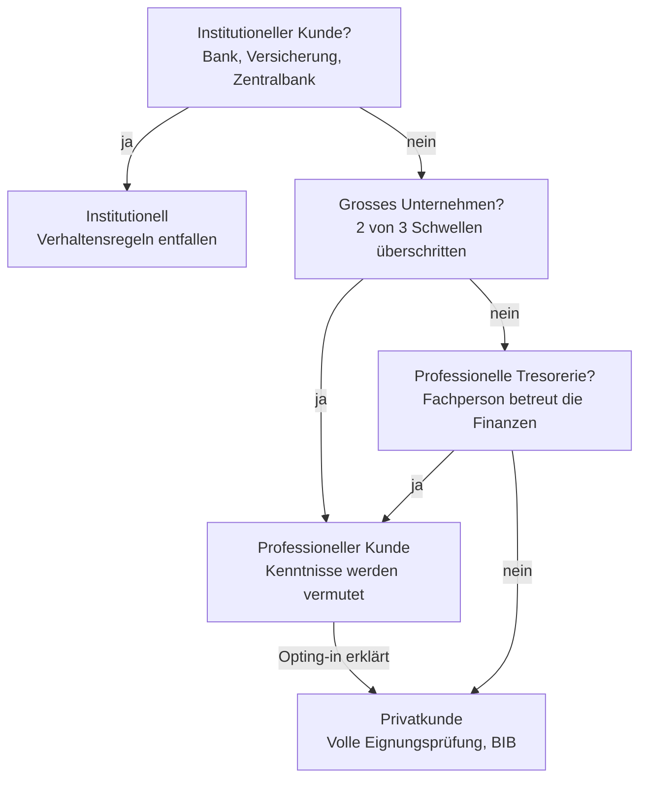

# Treasury Kompass One-Pager

Stand: 18.11.2026

## Problem und Zielgruppe

Firmenkunden tragen Währungs- und Zinsrisiken aus ihrem Geschäft. Eine Beratung dazu, die FIDLEG erfüllt, ist aufwendig und läuft heute grösstenteils von Hand.

- **Zielgruppe:** exportorientierte KMU und Mid-Caps in der Schweiz mit Umsätzen in EUR oder USD, variabel verzinsten Krediten und überschüssiger Liquidität.
- **Die meisten KMU sind Privatkunden:** Wer nicht 2 von 3 Schwellenwerten überschreitet (Bilanzsumme CHF 20 Mio., Umsatz CHF 40 Mio., Eigenkapital CHF 2 Mio.) und keine professionelle Tresorerie hat, ist nach FIDLEG Privatkunde. Dann gelten volle Eignungsprüfung, Basisinformationsblatt und Dokumentationspflicht.
- **Das Risiko steckt im Geschäft:** Es liegt in Umsätzen, Einkäufen und Krediten, nicht in einer Wertschriftenliste. Berater müssen es aus Jahresrechnung und Gesprächen zusammensuchen.
- **Beispiel aus der Demo:** Ein Maschinenbau-KMU erwartet netto EUR 14.2 Mio. Zuflüsse in 12 Monaten. Fällt der Euro um 10 %, kostet das rund CHF 1.3 Mio. oder 58 % des EBIT.

Echte institutionelle Kunden (Banken, Versicherungen) sind von den FIDLEG-Verhaltensregeln weitgehend ausgenommen. Dort gibt es wenig zu automatisieren, deshalb zielt das Tool auf Firmenkunden.

## Lösung

Treasury Kompass ist ein Copilot für Firmenkundenberater. Aus der Jahresrechnung entsteht in einem Termin ein begründeter Absicherungs- und Anlagevorschlag mit fertigem Beratungsprotokoll. Ein klickbarer Prototyp liegt unter [`reference/prototype/`](../reference/prototype/).

1. **Unterlagen:** Die Jahresrechnung wird ausgelesen. Jede Kennzahl trägt ihre Fundstelle und kann korrigiert werden.
2. **Risiken:** Das Tool zeigt, was eine Kursbewegung von 10 % oder ein Zinsanstieg um 1 Prozentpunkt das EBIT kostet.
3. **Fragebogen:** Gefragt wird nur, was in den Unterlagen fehlt. Vorbefüllte Antworten bestätigt der Berater.
4. **FIDLEG-Prüfung:** Feste Regeln bestimmen Kundensegment, Risikoprofil und Eignung pro Produkt.
5. **Vorschlag:** Gestaffelte Währungsabsicherung über 4 Quartale, Szenario-Rechnung und Aufteilung der überschüssigen Liquidität, jeweils mit Begründung.
6. **Protokoll:** Checkliste vor Abschluss, Freigabe durch den Berater, Beratungsprotokoll und Audit-Trail.

## FIDLEG-Regelwerk

Ein LLM liest die Unterlagen aus und formuliert die Begründung. Ob ein Produkt geeignet ist, entscheiden feste Regeln, und jede Entscheidung landet mit Rechtsgrundlage im Audit-Trail.

Für die meisten KMU endet die Kette beim Privatkunden mit voller Eignungsprüfung.

- **Risikoprofil:** Die Risikofähigkeit kommt aus den Zahlen (Eigenkapitalquote, Liquidität, EBIT-Marge, ungesichertes Währungsrisiko), die Risikobereitschaft aus dem Fragebogen, je 1 bis 5. Massgebend ist der tiefere Wert.
- **Eignung pro Produkt:** Bei Privatkunden entscheiden Kenntnisse und Erfahrung: geeignet, nur nach Aufklärung oder abraten (Art. 14). Bei professionellen Kunden werden sie vermutet.
- **Leitplanken:** Die Absicherungsquote ist durch die Treasury-Policy begrenzt und nie höher als 100 % der Nettoposition, sonst wäre es Spekulation.
- **Freigabe:** Erst wenn alle vorbefüllten Antworten bestätigt und die Checkliste erledigt ist. Jede spätere Änderung hebt sie wieder auf.

## MVP-Umfang und Roadmap

Der Prototyp deckt Währungsabsicherung und Liquiditätsanlage vollständig ab. Nur die PDF-Extraktion ist simuliert und lädt Beispieldaten von zwei erfundenen Kunden.

| Baustein | Status | Bemerkung |
| --- | --- | --- |
| Kennzahlen aus der Jahresrechnung mit Fundstelle | Simuliert | Demo lädt Beispieldaten; geplant ist Extraktion per LLM |
| Kundensegment und Opting-in | Im MVP | Regeln nach Art. 4 und 5 FIDLEG |
| Risikoprofil und Eignung pro Produkt | Im MVP | Risikofähigkeit und Risikobereitschaft, der tiefere Wert zählt |
| Währungsabsicherung EUR und USD mit Szenario | Im MVP | Termingeschäfte und Zero-Cost-Collar; Kurse und Zinsen sind Demo-Annahmen |
| Anlage der überschüssigen Liquidität | Im MVP | Festgeld, Geldmarktfonds, kurze Obligationen |
| Protokoll, Checkliste, Freigabe, Audit-Trail | Im MVP | Protokoll als Text kopierbar, noch kein PDF |
| Live-Kurse und Zinssätze vom SNB-Datenportal | Roadmap | ersetzt die Demo-Annahmen |
| Zinsabsicherung mit Swaps und Caps | Roadmap | Zinsrisiko wird heute schon erkannt |
| Rohstoff- und Energiepreise | Roadmap | Daten aus der Kreditorenbuchhaltung |
| Hedge Accounting und Meldepflichten nach FinfraG | Roadmap | relevant für Derivate bei Mid-Caps |
| Anbindung ans Kernbankensystem und PDF-Export | Roadmap | Voraussetzung für den Pilotbetrieb |

## Nutzen

Die Bank erschliesst Absicherungs- und Anlagegeschäft bei Firmenkunden, ohne dass die Compliance-Last mitwächst.

- **Bank:** mehr Geschäft mit Devisentermingeschäften und Liquiditätsanlagen im Firmenkundensegment. Jede Empfehlung ist mit Regel und Rechtsgrundlage dokumentiert.
- **Berater:** Vorbereitung, Eignungsprüfung und Protokoll entstehen aus den Unterlagen statt von Hand. Die Zeit geht ins Gespräch.
- **Kunde (CFO):** sieht in Franken, was eine Kursbewegung kostet und was die Absicherung bringt, inklusive der Kosten aus der Zinsdifferenz.

Wie viel Zeit pro Beratung wegfällt, ist noch nicht gemessen und sollte mit einem Firmenkundenberater geschätzt werden.

## Demo-Ablauf in 3 Minuten

Die Demo läuft am Export-KMU und zeigt drei Momente, in denen die Regeln sichtbar eingreifen.

1. **0:00 Problem:** Muster Maschinenbau AG, netto EUR 14.2 Mio. Zuflüsse. Ein Euro-Rückgang von 10 % kostet 58 % des EBIT.
2. **0:20 Unterlagen:** Kennzahlen mit Fundstelle zeigen. Bilanzsumme auf 21 setzen: Das Unternehmen wird live zum professionellen Kunden. Wert zurücksetzen.
3. **0:50 FIDLEG-Prüfung:** Entscheidungskette, Risikoprofil Konservativ, Zero-Cost-Collar nicht geeignet.
4. **1:20 Vorschlag:** Staffelung 80 / 70 / 60 / 50 %, Szenario bei −10 %: CHF −1.33 Mio. ohne und −0.57 Mio. mit Absicherung.
5. **1:50 Sperre:** Im Fragebogen Kenntnisse für Devisentermingeschäfte auf «Keine» setzen. Der Vorschlag wird gesperrt und rät ab.
6. **2:20 Protokoll:** Checkliste abhaken, freigeben, Audit-Trail zeigen. Eine spätere Änderung hebt die Freigabe auf.
7. **2:45 Schluss:** Roadmap und was wir von der Bank für einen Pilot bräuchten.

## Offene Punkte

Vor dem Pitch sind vor allem die Rechtsgrundlagen und der Rahmen des Hackathons zu klären.

- [ ] FIDLEG-Artikelangaben und die Vermutung bei professionellen Kunden mit jemandem aus Compliance gegenprüfen
- [ ] Klären, ob Absicherungsberatung für KMU in der Praxis als portfoliobezogene Beratung (Eignung) oder transaktionsbezogen (Angemessenheit) gilt
- [ ] Schwellen und Gewichte für Risikofähigkeit und Risikobereitschaft mit Fachleuten aus der Bank kalibrieren
- [ ] Challenge-Geber, Bewertungskriterien und Pitch-Dauer klären
- [ ] Entscheiden: nur Berater-Copilot oder zusätzlich ein Fragebogen, den der CFO vorab ausfüllt
- [ ] Echte LLM-Extraktion für 1 bis 2 Beispiel-PDFs bauen, damit Schritt 1 nicht mehr simuliert ist
- [ ] Datenschutz: echte Jahresrechnungen nur in geschützter Umgebung, Hosting des LLM in der Schweiz oder EU klären
